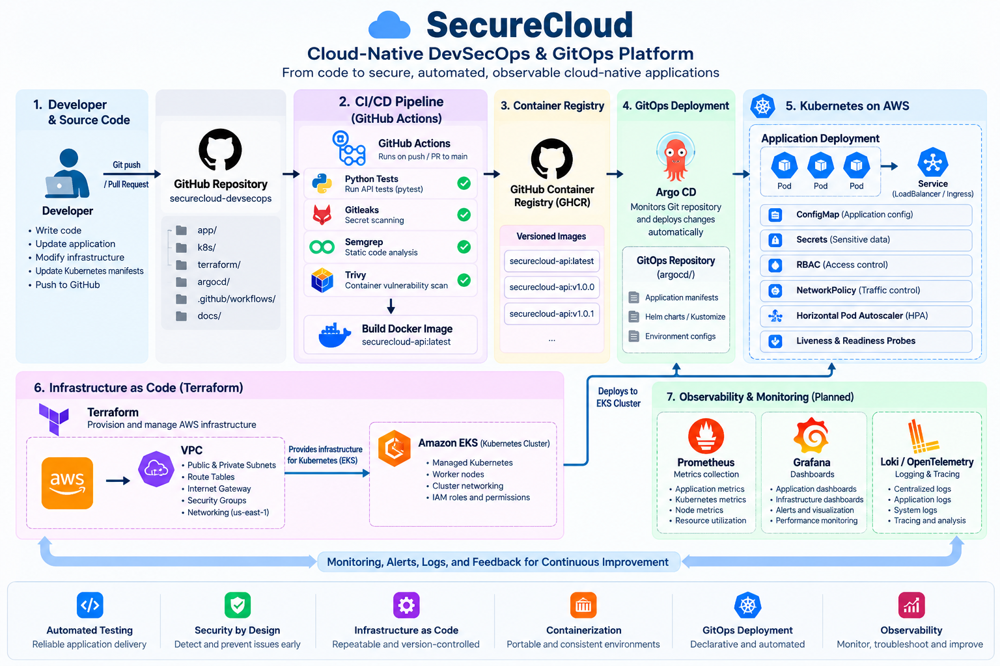

**\# ☁️ SecureCloud**

\### Cloud-Native DevSecOps \& GitOps Platform


\*\*Designing and building a secure, automated, and observable cloud-native platform using Infrastructure as Code, CI/CD, Kubernetes, DevSecOps, and GitOps.\*\*

## 🏗️ System Architecture




<p align="center">

&#x20; 

&#x20; 

&#x20; 

&#x20; 

&#x20; 

&#x20; 

</p>


\---


**\## 📖 Table of Contents**


\- \[Project Overview](#-project-overview)

\- \[Project Objectives](#-project-objectives)

\- \[System Architecture](#️-system-architecture)

\- \[Architecture Components](#-architecture-components)

\- \[End-to-End Workflow](#-end-to-end-workflow)

\- \[Technology Stack](#️-technology-stack)

\- \[Repository Structure](#-repository-structure)

\- \[Local Development](#-local-development)

\- \[Security Design](#-security-design)

\- \[Observability and Reliability](#-observability-and-reliability)

\- \[Engineering Principles](#-engineering-principles)

\- \[Documentation](#-documentation)


\---


**\## 🚀 Project Overview**


SecureCloud is a cloud-native DevSecOps and GitOps platform designed to bring application development, infrastructure provisioning, automated security, container delivery, Kubernetes deployment, and observability into one engineering workflow.


The platform uses a Python FastAPI application as its workload and integrates tools commonly used by Cloud, DevOps, Platform Engineering, and Site Reliability Engineering (SRE) teams.


Infrastructure is defined using Terraform, application workloads are packaged with Docker, and Kubernetes provides container orchestration. GitHub Actions automates testing and security validation, while the target deployment architecture incorporates a container registry and Argo CD for GitOps-based delivery.


Monitoring, metrics, logging, and reliability testing complete the intended operational workflow.


The goal is to demonstrate not just how to deploy an application, but how to design, secure, automate, observe, and troubleshoot the platform that runs it.


**\## 🎯 Project Objectives**


\- \*\*Infrastructure as Code:\*\* Define repeatable cloud infrastructure using Terraform.

\- \*\*Cloud Networking:\*\* Design VPC networking, subnets, routing, and security boundaries in AWS.

\- \*\*Application Containerization:\*\* Build reproducible Docker images for the API service.

\- \*\*Continuous Integration:\*\* Automate application tests and validation using GitHub Actions.

\- \*\*DevSecOps:\*\* Integrate secret scanning, static analysis, and container vulnerability scanning into the delivery pipeline.

\- \*\*Kubernetes Orchestration:\*\* Manage application workloads, configuration, service discovery, health checks, and resource usage.

\- \*\*GitOps Delivery:\*\* Use declarative deployment configuration and Argo CD to reconcile Kubernetes workloads.

\- \*\*Observability:\*\* Collect application metrics, visualize system health, and centralize operational logs.

\- \*\*Reliability Engineering:\*\* Exercise failure scenarios, validate recovery behavior, and document troubleshooting procedures.

\- \*\*Reproducible Engineering:\*\* Document implementation steps, commands, configuration, verification, and engineering decisions.


\---


**\## 🏗️ System Architecture**


The following diagram represents the \*\*overall target architecture of SecureCloud\*\*, from source-code changes through CI security checks, container publishing, GitOps deployment, Kubernetes workloads, and operational observability.


!\[SecureCloud — Complete DevSecOps and GitOps Platform Architecture](docs/securecloud-architecture.png)


\*Figure 1: End-to-end SecureCloud platform architecture.\*


**\### Architecture at a glance**


The architecture is organized into six connected layers:


1\. \*\*Source and version control\*\* — application code, infrastructure definitions, Kubernetes manifests, and deployment configuration stored in Git.

2\. \*\*Continuous integration\*\* — automated tests and security validation triggered by repository changes.

3\. \*\*Container delivery\*\* — Docker image creation, vulnerability assessment, and versioned image publishing.

4\. \*\*Infrastructure and orchestration\*\* — Terraform-managed AWS infrastructure and Kubernetes workloads.

5\. \*\*GitOps deployment\*\* — Argo CD continuously reconciles declared application configuration with the Kubernetes environment.

6\. \*\*Observability and reliability\*\* — metrics, dashboards, logging, alerting, and failure testing to support operational decisions.


The AWS infrastructure foundation and local Kubernetes environment are developed as distinct parts of the project. The end-to-end architecture describes how the components are intended to integrate as the platform evolves.


\---


**\## 🧩 Architecture Components**


\### 1. Application Layer


\*\*Python + FastAPI\*\*


The application provides an API workload used to demonstrate containerization, testing, deployment, health monitoring, and operational behavior.


Key endpoints include:


\- `/` — application root endpoint

\- `/health` — application health endpoint

\- `/ready` — readiness endpoint

\- `/metrics` — application metrics endpoint


Automated tests validate API behavior and provide feedback during development.


\### 2. Infrastructure Layer


\*\*AWS + Terraform\*\*


Terraform defines cloud infrastructure declaratively so networking resources can be reviewed and managed through version-controlled configuration.


The infrastructure design includes:


\- AWS Virtual Private Cloud (VPC)

\- Public and private subnets across availability zones

\- Internet Gateway and route tables

\- Network segmentation and security boundaries

\- Infrastructure configuration managed through Terraform


The AWS foundation is designed with cost awareness in mind. Resources that incur additional costs, such as NAT Gateways or managed Kubernetes clusters, must be evaluated before deployment.


\### 3. Container Layer


\*\*Docker\*\*


Docker packages the application and its dependencies into an image that can be built and executed consistently across environments.


The container workflow includes:


\- Building the application image

\- Installing Python dependencies

\- Running the API inside the container

\- Scanning the image for known vulnerabilities

\- Publishing versioned images to a container registry


\### 4. Continuous Integration and DevSecOps Layer


\*\*GitHub Actions + Security Tools\*\*


The CI pipeline automates validation whenever code changes are pushed or a pull request targets the main branch.


| Tool | Responsibility |

|---|---|

| GitHub Actions | Orchestrates automated workflows |

| pytest | Executes application tests |

| Gitleaks | Detects potential exposed secrets |

| Semgrep | Performs static application security analysis |

| Trivy | Scans container images for known vulnerabilities |


The security workflow is designed to identify issues early and enforce defined quality and vulnerability policies before images are promoted for deployment.


\### 5. Kubernetes and GitOps Layer


\*\*Kubernetes + Argo CD\*\*


Kubernetes manages application workloads and their runtime configuration.


The deployment design includes:


\- Deployments and multiple application replicas

\- Services for workload access

\- ConfigMaps for application configuration

\- Resource requests and limits

\- Liveness and readiness probes

\- Security contexts and RBAC

\- NetworkPolicy manifests

\- Declarative deployment management through Argo CD


GitOps separates application delivery from manual cluster changes. Argo CD is intended to reconcile the declared configuration in Git with the desired Kubernetes state.


\### 6. Observability and Reliability Layer


\*\*Prometheus + Grafana + Logging\*\*


The observability design provides visibility into application and platform behavior.


\- \*\*Prometheus:\*\* Collects metrics from instrumented workloads and supported targets.

\- \*\*Grafana:\*\* Presents metrics through dashboards.

\- \*\*Loki / OpenTelemetry:\*\* Supports the planned log collection and telemetry workflow.

\- \*\*Alerting:\*\* Surfaces operational conditions requiring attention.

\- \*\*Failure testing:\*\* Validates recovery, health checks, deployment behavior, and troubleshooting procedures.


Together, these capabilities are intended to support performance analysis, incident investigation, and reliability improvements.


\---


**\## 🔄 End-to-End Workflow**


The intended SecureCloud delivery workflow follows this sequence:


1\. A developer changes application code or platform configuration and pushes the change to GitHub.

2\. GitHub Actions runs automated application tests and configured security checks.

3\. Docker builds an image containing the application and its dependencies.

4\. Trivy evaluates the container image against its vulnerability database.

5\. An approved image is published to the configured container registry.

6\. Deployment configuration in Git describes the desired Kubernetes state.

7\. Argo CD reconciles the deployment configuration with the Kubernetes environment.

8\. Kubernetes runs the application workloads and manages their lifecycle.

9\. Prometheus, Grafana, and logging tools provide operational visibility.

10\. Reliability tests and troubleshooting evidence are used to improve the platform.


This workflow establishes a consistent path from source-code changes to deployment and operational feedback.


\---


**\## 🛠️ Technology Stack**


| Category | Technologies |

|---|---|

| Programming language | Python |

| API framework | FastAPI |

| Testing | pytest, HTTPX |

| Containerization | Docker |

| Cloud platform | Amazon Web Services (AWS) |

| Infrastructure as Code | Terraform |

| Container orchestration | Kubernetes |

| CI/CD automation | GitHub Actions |

| Secret scanning | Gitleaks |

| Static analysis | Semgrep |

| Container vulnerability scanning | Trivy |

| Container registry | GitHub Container Registry (GHCR) |

| GitOps | Argo CD |

| Metrics collection | Prometheus |

| Dashboards | Grafana |

| Logging and telemetry | Loki, OpenTelemetry |

| Version control | Git, GitHub |


\---


**\## 📁 Repository Structure**


The repository separates application code, infrastructure configuration, Kubernetes manifests, and automation workflows.


```text

securecloud/

├── .github/

│   └── workflows/

│       └── ci.yml

├── app/

│   ├── main.py

│   ├── requirements.txt

│   └── tests/

│       └── test\_api.py

├── k8s/

│   └── Kubernetes deployment and security manifests

├── terraform/

│   └── environments/

│       └── dev/

├── docs/

│   └── securecloud-architecture.png

├── Dockerfile

├── .dockerignore

├── .gitignore

└── README.md

```


Additional directories for GitOps configuration, monitoring, logging, and deployment automation can be organized as those components are introduced.


\---


**\## 💻 Local Development**


\### Prerequisites


\- Git

\- Python 3.13

\- Docker Desktop

\- A Kubernetes environment for deployment experiments

\- AWS CLI and Terraform for infrastructure exercises


\### Clone the repository


```bash

git clone https://github.com/teja-reddy43/securecloud-devsecops.git

cd securecloud-devsecops

```


\### Install application dependencies


```bash

python -m pip install -r app/requirements.txt

```


\### Run automated tests


```bash

python -m pytest -v

```


\### Build the Docker image


```bash

docker build -t securecloud-api:local .

```


\### Run the application container


```bash

docker run --rm -p 8000:8000 securecloud-api:local

```


Access the application at:


\- API root: `http://localhost:8000/`

\- Interactive API documentation: `http://localhost:8000/docs`

\- Health endpoint: `http://localhost:8000/health`

\- Readiness endpoint: `http://localhost:8000/ready`

\- Metrics endpoint: `http://localhost:8000/metrics`


These commands provide the local application and container workflow. Infrastructure and Kubernetes commands depend on the relevant environment configuration.


\---

## 📦 Container Image Publishing — GitHub Container Registry

SecureCloud's Docker image is published to GitHub Container Registry (GHCR), allowing the container to be pulled and run independently of the local build environment.

### Published image

| Property | Value |
|---|---|
| Registry | GitHub Container Registry (GHCR) |
| Image | `ghcr.io/teja-reddy43/securecloud-api` |
| Version | `1.0.0` |
| Image digest | `sha256:0036d8f7716825b7899bcd2c55726f885717aacf78523b3ae5ee9ff7b47d7fc2` |

### Authenticate with GHCR

Create a GitHub Personal Access Token with the required package permissions. Keep the token private and never commit it to the repository.

```bash
docker login ghcr.io -u teja-reddy43
```

Enter the token at Docker's password prompt.

### Tag and publish the image

```bash
docker tag securecloud-api:security-fix ghcr.io/teja-reddy43/securecloud-api:1.0.0

docker push ghcr.io/teja-reddy43/securecloud-api:1.0.0
```

### Pull and run the published image

```bash
docker pull ghcr.io/teja-reddy43/securecloud-api:1.0.0

docker run --rm -p 8000:8000 ghcr.io/teja-reddy43/securecloud-api:1.0.0
```

Open `http://localhost:8000/docs` to access the interactive API documentation.

### Verification results

The published image was pulled successfully from GHCR and executed locally.

- The FastAPI application started successfully.
- `GET /health` returned HTTP `200 OK`.
- The response body was `{"status":"healthy"}`.
- Requests to `/docs` and `/openapi.json` returned HTTP `200 OK`.

These checks verify that the published image can be retrieved and that the API starts and responds to requests. They do not, by themselves, establish production readiness.

## ☸️ Kubernetes Deployment and Verification

SecureCloud is deployed to a local Kubernetes cluster running through Docker Desktop. The application image is pulled from GitHub Container Registry (GHCR) and runs as a Kubernetes Deployment with two replicas.

### Deployment Environment

| Property | Value |
|---|---|
| Kubernetes context | `docker-desktop` |
| Namespace | `securecloud` |
| Deployment | `securecloud-api` |
| Container image | `ghcr.io/teja-reddy43/securecloud-api:latest` |
| Replicas | 2 |
| Service type | `ClusterIP` |
| Service port | `8000` |

### Verify the Deployment

Check the Kubernetes context and node:

```bash
kubectl config current-context
kubectl get nodes
```

Check the deployment and running pods:

```bash
kubectl get deployments -n securecloud
kubectl get pods -n securecloud
```

Check the container image used by the deployment:

```bash
kubectl get deployment securecloud-api -n securecloud -o jsonpath="{.spec.template.spec.containers[0].image}"
```

Wait for the rollout to complete:

```bash
kubectl rollout status deployment/securecloud-api -n securecloud --timeout=120s
```

### Verify Service Connectivity

Inspect the Kubernetes Service and its endpoints:

```bash
kubectl get service,endpoints -n securecloud
```

Forward local port `8000` to the Kubernetes Service:

```bash
kubectl port-forward service/securecloud-api 8000:8000 -n securecloud
```

Keep the port-forward command running in one terminal. Open another terminal and test the endpoints:

```bash
curl http://localhost:8000/health
curl http://localhost:8000/ready
```

Expected responses:

```json
{"status":"healthy"}
```

```json
{"status":"ready"}
```

### Deployment Validation Results

The following checks have been completed successfully:

- The GHCR image was pulled and deployed to the local Kubernetes cluster.
- The deployment rollout completed successfully.
- Both application replicas reached the `Running` and `Ready` state.
- The Kubernetes Service exposed port `8000` and reported two pod endpoints.
- The `/health` endpoint returned `{"status":"healthy"}`.
- The `/ready` endpoint returned `{"status":"ready"}`.

During rollout, the new pod initially experienced startup-probe failures. The application subsequently started successfully, and the rollout completed. This highlights the importance of checking container logs, pod events, health probes, and rollout status rather than relying on deployment commands alone.

These results validate the current local deployment workflow. They do not establish that the application is production-ready or that every planned platform component has been implemented.

🛡️** DevSecOps Security Gates — Stage 7**

Completed and verified
The GitHub Actions workflow includes the following required jobs:
- Tests: application tests using pytest.
- Gitleaks: secret scanning.
- Semgrep: static application security analysis.
- Trivy: container image vulnerability scanning, configured to fail on CRITICAL/HIGH findings that are not ignored by the configured policy.
- Checkov: Kubernetes manifest security checks against k8s/.
- GHCR publishing: publishes the container image after the required validation jobs pass.
The complete workflow, including Checkov and GHCR publishing, passed for commit c122e3d. Checkov findings were addressed by setting an explicit image pull policy, pinning the image by digest, and removing an unused secret reference from the Deployment. The application does not currently consume DEMO_SECRET; the local k8s/secret.yaml remains untracked/ignored and must not be committed.
Outstanding runtime issue: private GHCR image pull
The CI/security-gate work above is complete. A separate local-cluster authentication issue remains open and must not be represented as a passing deployment test.

Observations:
- docker pull ghcr.io/teja-reddy43/securecloud-api:1.0.0 succeeded locally and reported digest sha256:0036d8f7716825b7899bcd2c55726f885717aacf78523b3ae5ee9ff7b47d7fc2.
- Kubernetes pod events reported 401 Unauthorized while requesting an anonymous GHCR token for the private package, resulting in ErrImagePull / ImagePullBackOff.
- The securecloud namespace contains a Secret named ghcr-pull-secret of type kubernetes.io/dockerconfigjson; a non-sensitive structure check confirmed a ghcr.io auth entry exists. This confirms the Secret's structure, but does not prove the stored PAT is valid or authorized for the package.
- k8s/deployment.yaml was updated to reference imagePullSecrets: - name: ghcr-pull-secret and pushed in commit 363a1c2 (Fix private GHCR image pulls in Kubernetes). The resulting pull has not yet been verified as successful.
- At the latest reported check, Argo CD showed Synced / Progressing; one pod was ImagePullBackOff, another was Running but not Ready, and one older pod was Running / Ready. The cluster also had recent instability and elevated container restarts.
Current status: CI/CD security gates and image publishing are complete; private registry authentication for the local Kubernetes runtime remains unresolved. Do not claim the current deployment is healthy until both replicas are Ready and the Argo CD Application reports Healthy.
Safe diagnostic commands
kubectl get secret ghcr-pull-secret -n securecloud
kubectl get pods -n securecloud
kubectl get application securecloud -n argocd
kubectl describe pod <pod-name> -n securecloud
Do not print, paste into chat, or commit the PAT or the decoded .dockerconfigjson data. Keep the Kubernetes pull Secret out of Git.
Useful commands
Check Application status:
kubectl get application securecloud -n argocd

Check the deployment and pods:
kubectl get deployment,pods,service -n securecloud

Forward the API locally and test health/readiness from a second terminal:
kubectl port-forward service/securecloud-api 8000:8000 -n securecloud
curl http://localhost:8000/health
curl http://localhost:8000/ready


**\## 🔐 Security Design**


Security is integrated into the platform's development and deployment workflow.


The design incorporates:


\- Automated secret detection

\- Static code analysis

\- Container vulnerability scanning

\- Least-privilege access through Kubernetes RBAC

\- Container and pod security contexts

\- Resource constraints and health probes

\- NetworkPolicy manifests for workload traffic controls

\- Version-controlled infrastructure definitions

\- Careful handling of environment variables, credentials, and Terraform state


Security controls must be verified in their actual execution environment. For example, the presence of a Kubernetes NetworkPolicy manifest alone does not prove that network isolation is enforced; the cluster networking implementation and policy behavior must also be tested.


Secrets, local environment files, credentials, and Terraform state files should not be committed to the public repository.


\---


**\## 📈 Observability and Reliability**


SecureCloud's observability design focuses on understanding both application health and platform behavior.


The intended capabilities include:


\- Application health and readiness checks

\- Request and application metrics

\- Resource utilization monitoring

\- Dashboards for operational visibility

\- Centralized logs and telemetry

\- Deployment and pod-recovery validation

\- Failure scenarios and troubleshooting exercises


The objective is to connect operational signals to engineering actions: detect a problem, investigate the cause, validate a fix, and record the result.


\---


**\## 🧠 Engineering Principles**


SecureCloud follows these principles throughout its development:


\- \*\*Automation first:\*\* Prefer repeatable workflows over manual procedures.

\- \*\*Security by design:\*\* Integrate security checks early in the delivery process.

\- \*\*Infrastructure as Code:\*\* Keep infrastructure definitions version-controlled and reviewable.

\- \*\*Declarative operations:\*\* Describe desired system state and reconcile toward it.

\- \*\*Cost awareness:\*\* Evaluate cloud costs before creating billable resources.

\- \*\*Observable systems:\*\* Design for monitoring, diagnosis, and troubleshooting.

\- \*\*Evidence-based validation:\*\* Distinguish a configuration being present from a control being tested and proven.

\- \*\*Documentation as part of engineering:\*\* Record commands, architecture, decisions, problems, and lessons learned.


\---


**\## 📚 Documentation**


This README provides the project overview and overall system architecture. Detailed implementation notes will be maintained as the project evolves, including:


\- Stage-by-stage implementation procedures

\- Configuration files and commands

\- Architecture decisions and trade-offs

\- Test results and verification evidence

\- Troubleshooting and issue resolution

\- Deployment and operational procedures

\- Cost considerations and lessons learned


\---


**\## 🔗 Repository**


\*\*GitHub:\*\* \[teja-reddy43/securecloud-devsecops](https://github.com/teja-reddy43/securecloud-devsecops)


SecureCloud is an evolving engineering project focused on demonstrating the design and operation of a secure, automated, and observable cloud-native platform.

